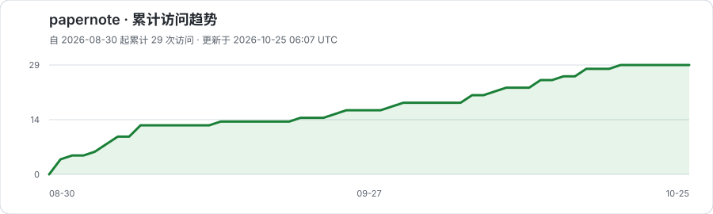

# SecPaper

SecPaper 是一个面向安全研究者和工程师的中文论文阅读站。它每周整理安全论文，提供结构化精读、必要的名词解释、作者与单位关系，以及有证据基础的行业观点。

在线浏览：<https://wyinleo.github.io/SecPaper/>

## 仓库内容

- **学术论文**：按周次或安全主题浏览论文，左侧导航默认显示 5 条，可展开或收起；“论文来源”按 CCF-A 会议系列的标准简称汇总，同一会议的主会、数据集赛道和研讨会显示在一个来源类目中，论文详情仍保留真实出处与接收状态；详情顶部按单位列出作者，Easycatch 从生活故事或实际使用场景切入，再接到论文的问题与思路，再展开方法示例、实验、局限和实践意义。
- **学术关系**：在平面全球地图上按国家 / 地区查看库内论文分布，色深表示去重论文数，虚线弧线表示跨国 / 地区合作，不显示自环；悬停国家时显示合作连线，移开隐藏；支持键盘聚焦和触屏轻触。下方按国家、单位、学者分三列排名，可按年份、学科和单位查看关系。单位按已核验的大学或机构归并，原始院系署名保留在论文详情。地图含预印本，单位与学者的顶会分数单独保留核验口径，不代表完整排名。
- **行业观点**：精选包含原创方法、数据、漏洞细节或工程经验的公开报告，并注明证据边界与商业利益相关。

论文周报保存在 [`weekly/`](weekly/)，适合直接阅读或引用。论文索引与行业观点分别保存在 [`papers/index.jsonl`](papers/index.jsonl) 和 [`industry/viewpoints.json`](industry/viewpoints.json)。具体的论文阅读和整理方式见 [`docs/paper-reading-guide.md`](docs/paper-reading-guide.md)。

<!-- secpaper-distribution:start -->
### 论文收录分布

首页按论文领域统计，共收录 **148 篇**；其中 **133 篇**纳入顶会统计。

- **安全四大**：106 篇
- **软件工程**：16 篇
- **人工智能**：11 篇
- **预印 / 其他**：15 篇
<!-- secpaper-distribution:end -->

## 本地浏览

项目只使用静态 HTML、CSS 和 JavaScript。需要 Python 3，无需安装前端框架：

```bash
python3 scripts/build_site.py --check
python3 scripts/build_site.py
python3 -m http.server 8000 -d site
```

然后访问 <http://localhost:8000>。

## 部署


